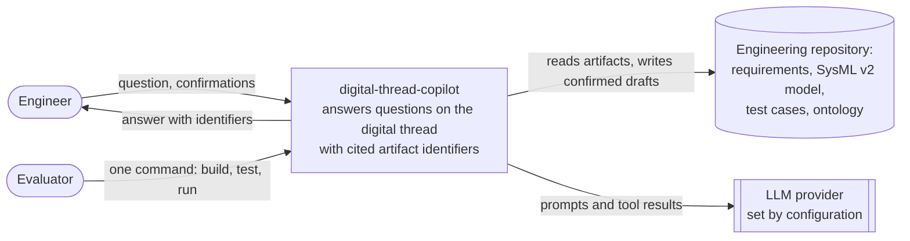
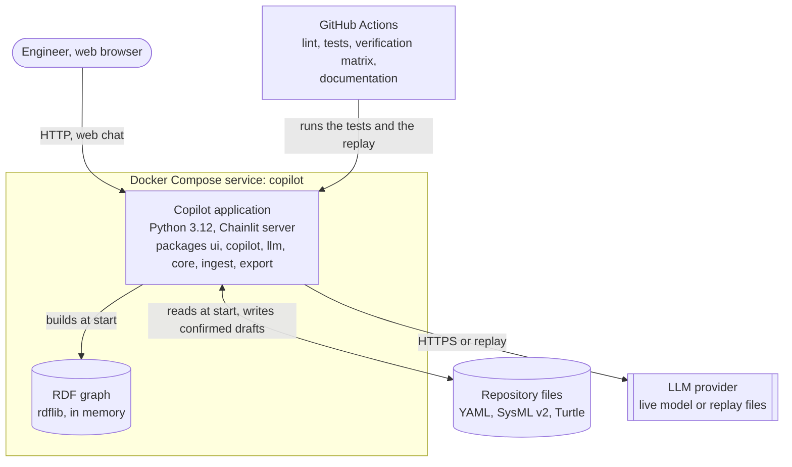
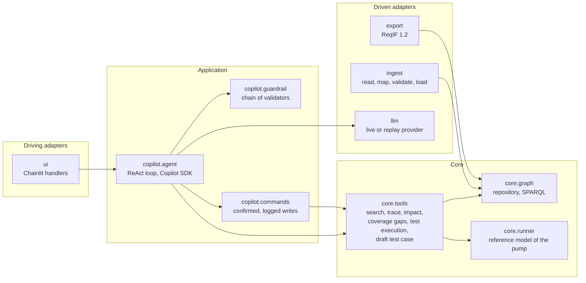
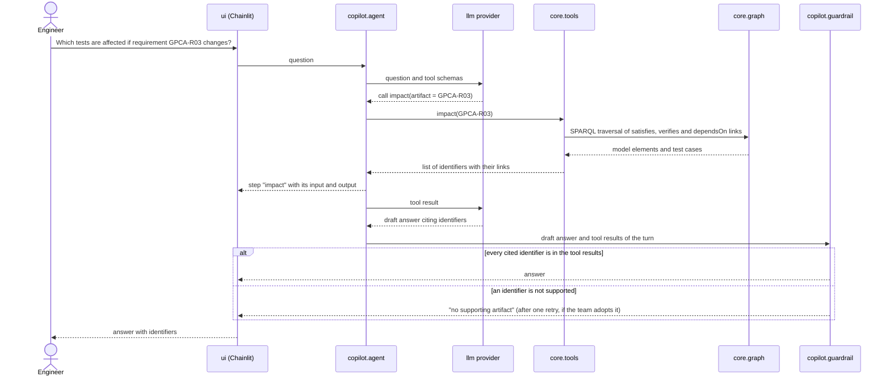

# Architecture

!!! note "Status"
    Objectives validated by the professor in class on 2026-11-19, with the request to name the architecture, the design patterns, the ontology and the format of every artifact: this page answers it. No component described here is implemented yet, except the package skeleton. Requirement identifiers are those of the project requirements draft (step C1).

The system answers traceability, impact and coverage questions of an engineer by letting a language model call deterministic tools over a graph of the project artifacts. The model never reads the artifacts directly: it chooses tools, and every identifier in an answer must come from a tool result.

## Basis of the description

The description follows the terms of ISO/IEC/IEEE 42010:2022 (stakeholders, their concerns, and one view per group of concerns). The diagrams follow the levels of the C4 model: system context, containers, components, plus one dynamic view.

| Stakeholder | Concern | View |
| --- | --- | --- |
| Engineer | Which artifacts answer my question, and can I trust them? | 1 Context, 4 Dynamic |
| Evaluator, teaching staff | Can I build, test and run it with one command, with or without a model key? | 2 Containers |
| Development team | Where does each responsibility live, and what may depend on what? | 3 Components |
| Panel of the defense | Is the traceability claim visible and checkable? | 4 Dynamic, verification matrix |

## Style and design patterns

Hexagonal architecture (ports and adapters): the graph and the tools are the core; formats, model provider and interface are adapters at the edge. Decision, options and references: [ADR-0017](adr/0017-architectural-style-and-design-patterns.md).

| Pattern | Where it applies | Package |
| --- | --- | --- |
| Hexagonal (ports and adapters) | Whole system; the core defines the ports | all |
| Pipes and Filters | Ingestion: read, map to RDF, validate with SHACL, load | `ingest` |
| Adapter | One adapter per format in, ReqIF 1.2 out | `ingest`, `export` |
| Repository | Tools read the graph through one object that runs the SPARQL queries | `core` |
| ReAct | Agent loop on the GitHub Copilot SDK: reason, call a tool, read, answer | `copilot` |
| Chain of Responsibility | Validators of an answer before it is shown | `copilot` |
| Command | Write actions: confirmed by the engineer, then executed and logged | `copilot` |
| Strategy | Model provider by configuration: live or replay | `llm` |

Dependency rule, enforced in CI by an import-linter contract from the first code of block G: `core` imports nothing of the project; `ingest`, `export` and `copilot` import `core`; `llm` and `ui` import `copilot`.

## View 1: system context (C4 level 1)

The engineering repository is the source of truth. The LLM provider is outside the system and chosen by environment settings ([ADR-0010](adr/0010-llm-access-and-replay-mode.md)); with no credential, the replay provider serves recorded responses for the tests and the demonstration.

## View 2: containers (C4 level 2)

| Container | Technology | Decision records |
| --- | --- | --- |
| Copilot application | Python 3.12, Chainlit (pinned), one process | [ADR-0007](adr/0007-user-interface-chat-framework.md), [ADR-0011](adr/0011-packaging-docker-compose.md) |
| RDF graph | rdflib, in memory, rebuilt from the files at start | [ADR-0003](adr/0003-graph-store-rdflib.md) |
| Repository files | YAML, SysML v2 textual notation, Turtle | [ADR-0004](adr/0004-sysml-v2-parsing.md), [ADR-0005](adr/0005-requirements-format.md) |
| LLM provider | Live model through the GitHub Copilot SDK, or recorded responses | [ADR-0002](adr/0002-agent-stack-github-copilot-sdk.md), [ADR-0010](adr/0010-llm-access-and-replay-mode.md) |
| Continuous integration | GitHub Actions | [ADR-0013](adr/0013-code-quality-tools.md) |

## View 3: components (C4 level 3)

| Component | Responsibility | Pattern | Decision records | Plan steps |
| --- | --- | --- | --- | --- |
| `ingest` | Reads each artifact format and loads nodes and links into the graph; fails on malformed input or SHACL violation | Pipes and Filters, Adapter | [ADR-0004](adr/0004-sysml-v2-parsing.md), [ADR-0005](adr/0005-requirements-format.md) | G1 to G3 |
| `core.graph` | Holds the digital thread; the only code that runs SPARQL | Repository | [ADR-0003](adr/0003-graph-store-rdflib.md) | E1, E2 |
| `core.tools` | Deterministic functions with a declared JSON Schema; the only way for the agent to read or act | | [ADR-0002](adr/0002-agent-stack-github-copilot-sdk.md) | H1, H4 |
| `core.runner` | Runs the case study test cases against the reference model and writes JUnit XML results | | [ADR-0006](adr/0006-test-execution-target.md) | D4 |
| `copilot.agent` | Sends the question to the model with the tool schemas, runs the tool calls, returns a draft answer | ReAct | [ADR-0002](adr/0002-agent-stack-github-copilot-sdk.md) | H2, H6 |
| `copilot.guardrail` | Blocks an answer whose identifiers are not in the tool results of the turn | Chain of Responsibility | [ADR-0016](adr/0016-guardrail-against-ungrounded-identifiers.md) (proposed) | H3 |
| `copilot.commands` | Shows each write to the engineer, executes it after confirmation, logs it | Command | [ADR-0017](adr/0017-architectural-style-and-design-patterns.md) | H3, H4 |
| `llm` | Live provider or replay of recorded responses, chosen by environment settings | Strategy | [ADR-0010](adr/0010-llm-access-and-replay-mode.md) | H7 |
| `ui` | Chat: question in, steps of the agent and grounded answer out; no logic | Adapter | [ADR-0007](adr/0007-user-interface-chat-framework.md) | H8 |
| `export` | Writes the requirements as ReqIF 1.2 | Adapter | [ADR-0005](adr/0005-requirements-format.md) | D2 |
| Evaluation harness (`eval/`) | Runs the reference questions in the three configurations and computes the metrics | | [ADR-0008](adr/0008-manual-baseline-design.md), [ADR-0015](adr/0015-evaluation-model.md) (proposed) | I1, I2 |

## View 4: dynamic view of one query

Question taken from the project statement: "which tests are affected by this change?"

The identifier `GPCA-R03` is an example from the draft of step D2.

## Formats and files

| Artifact | Format | File in the repository | Decision records |
| --- | --- | --- | --- |
| Project requirements | YAML, validated by JSON Schema (draft-07) | `requirements/requirements.yaml` | [ADR-0005](adr/0005-requirements-format.md) |
| Case study requirements | YAML, validated by JSON Schema (draft-07); export ReqIF 1.2 (OMG) | `data/gpca/requirements.yaml`, export `data/gpca/requirements.reqif` | [ADR-0005](adr/0005-requirements-format.md) |
| System model | SysML v2 textual notation (OMG) | `data/gpca/model/gpca.sysml` | [ADR-0004](adr/0004-sysml-v2-parsing.md) |
| Case study test cases | YAML (given, when, then), validated by JSON Schema | `data/gpca/tests/test-cases.yaml` | [ADR-0005](adr/0005-requirements-format.md), [ADR-0006](adr/0006-test-execution-target.md) |
| Test results | JUnit XML | `reports/` (generated) | [ADR-0017](adr/0017-architectural-style-and-design-patterns.md) |
| Reference traces | CSV | `data/gpca/gold-links.csv` | |
| Ontology | OWL 2, Turtle | `ontology/digital-thread.ttl` | [ADR-0003](adr/0003-graph-store-rdflib.md) |
| Integrity rules | SHACL (W3C), Turtle | `shapes/digital-thread-shapes.ttl` | [ADR-0003](adr/0003-graph-store-rdflib.md) |
| Queries | SPARQL 1.1 | `ontology/competency-questions/cq01.rq` to `cq10.rq` | [ADR-0003](adr/0003-graph-store-rdflib.md) |
| Tool interfaces | JSON Schema, one per tool | `src/digital_thread_copilot/core/tools/` | [ADR-0002](adr/0002-agent-stack-github-copilot-sdk.md) |
| Verification matrix | Markdown and CSV, in the four blocks of the course matrix | `reports/vcrm.md`, `reports/vcrm.csv` (generated in CI) | |
| Decision records | MADR 4.0.0 | `docs/adr/` | [ADR-0000](adr/0000-use-madr.md) |

## Knowledge graph and ontology

| Question | Answer |
| --- | --- |
| What does it model? | The digital thread of a system: the classes Requirement, ModelElement (with PartDefinition and PortDefinition), TestCase and TestResult, all subclasses of Artifact and pairwise disjoint; the relations satisfies (model element to requirement), verifies (test case to requirement), dependsOn (artifact to artifact, followed with a property path for impact) and reportsOn (test result to test case). Identifier, title, text and source come from Dublin Core terms (`dcterms`). |
| In which language? | OWL 2, written in Turtle. Terms are aligned with OSLC Requirements Management 2.1 and Quality Management 2.1 (for example, verifies is a subproperty of `oslc_qm:validatesRequirement`), and each term carries the name of the SysML v2 metaclass it comes from. Integrity rules in SHACL: 5 node shapes. |
| In which file? | `ontology/digital-thread.ttl` (namespace `https://tsp-uc3m.github.io/digital-thread-copilot/ontology#`, prefix `dtc`), `shapes/digital-thread-shapes.ttl` and its negative fixtures, `ontology/competency-questions/` (10 SPARQL queries the ontology must answer). The page `docs/04-ontology.md` is generated from the ontology file. |
| With which tools? | rdflib (graph and SPARQL 1.1), pySHACL (validation), in the ingestion pipeline and in CI. |
| Verification methods | VerificationMethod, a closed class of four individuals (Inspection, Analysis, Demonstration, Test, the methods of the verification matrix and of the SysML v2 library `VerificationCases::VerificationMethodKind`), and the property hasVerificationMethod from a requirement to at most one method, checked by SHACL. In the draft of step E1 since 2026-11-21. |

## Components and requirements

Provisional matrix, to regenerate from `requirements/requirements.yaml` once step C1 is in the repository (step F7 generates the full traceability page).

| Requirement | ingest | core.graph | core.tools | core.runner | copilot.agent | copilot.guardrail | copilot.commands | llm | ui | eval |
| --- | --- | --- | --- | --- | --- | --- | --- | --- | --- | --- |
| FR-ING-01 to FR-ING-03, ingestion of the 3 artifact types | x | x | | | | | | | | |
| FR-KG-01, FR-KG-02, graph and SHACL validation | x | x | | | | | | | | |
| FR-TOOL-01 to FR-TOOL-05, deterministic tools | | x | x | x | | | | | | |
| FR-AGT-01, FR-AGT-02, answers with cited identifiers | | | x | | x | | | x | | |
| FR-GEN-01 and FR-GEN-04, draft test case validated before being proposed | | | x | | x | | x | | | |
| FR-GRD-01 to FR-GRD-04 and NFR-SEC-02, grounded answers, confirmed and logged writes | | | | | x | x | x | | | |
| FR-UI-01, web chat | | | | | | | | | x | |
| FR-EVAL-01 and NFR-OPS-02, metrics computed automatically | | x | | | x | | | x | | x |
| NFR-OPS-03, demonstration without credential | | | | | | | | x | | |

Extensions outside the committed scope, built only if time allows: re-ingestion on every change (FR-ING-04), generation of SysML v2 snippets and traceability reports (FR-GEN-02, FR-GEN-03), view of the queried subgraph and of the end-to-end trace (FR-UI-02).

## Design rules

1. The repository is the single source of truth: the graph is rebuilt from the files and is never edited by hand.
2. The model reaches the artifacts only through tools; the agent is restricted to our tools by an allowlist.
3. Read tools and write commands are separate; a write needs the engineer's confirmation and leaves one log entry.
4. Every answer cites artifact identifiers that exist in the graph, or says that no artifact supports it.
5. The same agent runs with zero tool as the reference configuration of the evaluation (see the evaluation protocol).
6. Model, provider, endpoint and key are environment settings.
7. Dependencies point to the core: the dependency rule above is checked in CI, and the interface holds no logic.

## Known limits

- Only the subset of SysML v2 used by the case study is parsed.
- The graph lives in memory: nothing is claimed about large models.
- The reference model that executes the tests is written by the team, not taken from the published artifacts.
- The agent's own instructions come with the SDK and cannot be fully replaced; their effect is part of what the evaluation measures.
- Chainlit is community-maintained since May 2025; the version is pinned and the interface layer is kept thin so that it can be replaced ([ADR-0007](adr/0007-user-interface-chat-framework.md)).
